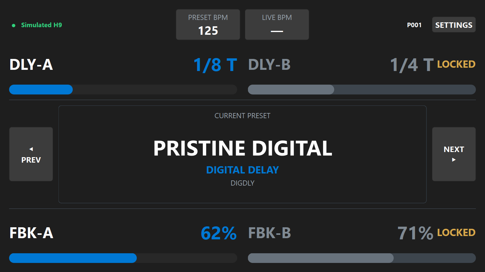

A minimal USB/MIDI controller for the Eventide H9: a touchscreen dashboard (built
for a Raspberry Pi) for jumping straight between presets and keeping the H9's
tempo in sync with live audio.

The motivation: jumping directly between note divisions — e.g. from 1/1 to 1/8
echo — without stepping through triplets and other in-between values, as on the
H9 itself.

## Features



- Preset navigation plus five jump keys for direct preset access
- Live BPM detection from an audio input
- Locked BPM mode (send once to the H9) or continuous live BPM mode
- Adjust the four main knobs of the current preset
- Settings stored in `config.json` (shortcuts, audio, knob order, locks)
- GPIO buttons and rotary encoders on the Raspberry Pi
- Built-in H9 simulator — try the dashboard without any hardware

## Install & run

Development (Windows/macOS), with [uv](https://docs.astral.sh/uv/):

```bash
uv sync
uv run python ui_main.py    # or: uv run h9-control
```

Try it without an H9 connected, audio input, or GPIO:

```bash
uv run python ui_main.py --simulate-h9 --no-audio --no-gpio --no-config-save
```

(`--simulate-h9` is also used by automated screenshot tooling. Add
`--no-config-save` for try-it/dev runs so simulated state — device fallbacks,
lock toggles — is never written back to `config.json`.)

Raspberry Pi: see `INSTALL_RASPBERRY_PI.md` — `linux/install.sh` sets up
system dependencies and installs a systemd service that starts the dashboard
on boot.

## Keyboard shortcuts

All bindings are configurable in `config.json` (`shortcuts.keyboard`).
Defaults:

| Keys | Action |
|---|---|
| `Left` / `Right` | Previous / next preset |
| `Z` `X` `C` `V` `B` | Jump to preset 1–5 |
| `1`–`4` / `Q`–`R` | Raise / lower the four main knobs (order set by `knob_order`) |
| `5` / `T` | BPM up / down |
| `D` | Sync live BPM to the H9 |
| `S` | Settings |
| `F5` | Connect / refresh |

## CLI

`python main.py` (or `uv run h9-control-cli`) connects over MIDI, dumps and
prints the current preset snapshot, then exits.

- `--log-level LEVEL` — verbosity (also via `H9_LOG_LEVEL` env var)
- `--print-bpm` — also request and print the current BPM
- `--next-preset` — send a Program Change to the next preset and re-dump it
- `--midi-channel CHANNEL` — channel for the Program Change (0-15, default 0)
- `--listen` — keep listening and print every incoming MIDI message until Ctrl-C

## Documentation

- H9 SysEx messages: `documentation/Eventide h9 141309_MIDISysexMessages.pdf`
- H9 Algorithm Guide: `documentation/H9AlgorithmGuide+V12.pdf`
